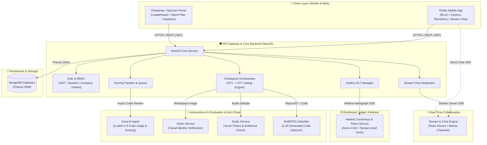

# 🏆 Arena of Coders — Competitive Hackathon Platform & Autonomous AI Evaluator

[](https://flutter.dev)
[](https://nestjs.com)
[](https://www.typescriptlang.org)
[](https://www.prisma.io)
[](https://www.mongodb.com)
[](https://hedera.com)
[](https://groq.com)
[](https://getstream.io)
[](https://opensource.org/licenses/MIT)

> **Arena of Coders** is a next-generation hackathon management and competition platform built for engineering schools, universities, and enterprise hackathons. It automates hackathon workflows through **7 progressive checkpoints (CP1–CP7)**, evaluates participant code in real time using **autonomous multi-agent AI judges (Groq / LLaMA)**, validates competitor integrity via **multi-modal anti-cheat microservices (facial, vocal, and RoBERTa AI-generated code detection)**, and disburses immutable awards via **Hedera Hashgraph Distributed Ledger (Arena Coin & Smart Badges)**.

---

## 🗂️ Multi-Branch & Repository Architecture

To maintain high code cohesion and independent deployment lifecycles, **Arena of Coders** is organized into specialized branches and companion repositories:

| Component | Target Location | Description & Stack |
| :--- | :--- | :--- |
| **System Overview & Docs** | **`main`** *(this branch)* | Global architecture, system blueprints, deployment guides, and project documentation |
| **Mobile Client** | [**`frontend` branch**](https://github.com/negzaoui16/Arena-Of-Coders/tree/frontend) | Production Flutter mobile application (BLoC state management, Checkpoint flow, Biometric scanner, Stream Chat UI) |
| **Backend API Gateway** | [**`backend` branch**](https://github.com/negzaoui16/Arena-Of-Coders/tree/backend) | Scalable NestJS API (Prisma ORM, MongoDB, Hedera SDK, Groq AI Agents, Stream Server, JWT Auth) |
| **AI Anti-Cheat Models** | [**`Arena-Of-Coders-AI-AntiCheat`**](https://github.com/negzaoui16/Arena-Of-Coders-AI-AntiCheat) | Dedicated repository for AI inference models (Face recognition, Vocal timbre verification, RoBERTa LLM code detector) |

---

## 🏛️ System Architecture

The following diagram illustrates the complete end-to-end data flow and interaction between the Flutter mobile client, the NestJS API gateway, external cloud integrations, and the autonomous AI evaluation services:



---

## 🌟 Key Features

### 1. 🎯 7-Stage Progressive Checkpoint Gating
Competitions follow a rigorous milestone-based structure where teams must clear sequential checkpoints before the final pitch:
* **CP1: Ideation & Problem Definition** — Problem statement validation, target market analysis.
* **CP2: UX/UI Wireframes & Prototype** — Figma/design submission and user journey mapping.
* **CP3: Architecture & Data Model** — Database schemas, system components, API contracts.
* **CP4: Core MVP Implementation** — Initial functioning codebase and repository commit validation.
* **CP5: Feature Freeze & Integration** — Integration of third-party APIs and automated testing.
* **CP6: AI & Security Hardening** — Vulnerability scanning, anti-cheat validation, and AI model tuning.
* **CP7: Final Demo & Pitch Deck** — Live demo link, video pitch, and presentation slides.

### 2. 🤖 Multi-Agent Autonomous AI Scoring
* **Code Quality & Architecture**: Evaluates maintainability, modularity, adherence to SOLID principles, and clean code conventions.
* **Git Velocity & Contribution**: Analyzes team member commit distribution, PR velocity, and authentic contributions.
* **Automated Feedback Generation**: Generates actionable, instant technical feedback to help teams improve between checkpoints.

### 3. 🛡️ Multi-Modal Anti-Cheat & Identity Verification
* **Facial Biometrics**: Matches participant selfies against registration photos during checkpoint submissions to ensure team authenticity.
* **Vocal Analysis**: Detects unauthorized background audio, secondary voices, and verifies speaker identity during video/audio submissions.
* **RoBERTa Synthetic Code Detection**: Scans submitted code to detect cut-and-paste LLM-generated code vs. organically typed code.

### 4. ⛓️ Hedera Hashgraph Distributed Ledger
* **Arena Coin Token**: Native hackathon currency minted on Hedera Token Service (HTS) to reward checkpoint completions.
* **Verifiable Credentials**: Final certificates and awards are cryptographically recorded on Hedera Consensus Service (HCS), providing tamper-proof proof of participation for LinkedIn and CVs.

### 5. 💬 Real-Time In-App Collaboration (Stream.io)
* Dedicated private team channels for real-time messaging, code snippet sharing, and strategy discussions.
* Direct mentor hotline channels for real-time judge and mentor guidance during the competition.

### 6. 💼 Enterprise & Sponsor Talent Discovery Portal
* Real-time dynamic leaderboard with customizable filtering (e.g., top Flutter developers, top AI engineers, highest clean-code score).
* Automated candidate scorecards with detailed technical breakdowns, enabling sponsors to hire top hackathon talent directly.

---

## 🛠️ Technology Stack

| Layer | Technologies |
| :--- | :--- |
| **Mobile Client** | Flutter 3.x, Dart 3.x, flutter_bloc, Dio, Stream Chat Flutter, Camera & Biometrics |
| **Backend API** | NestJS 11.x, TypeScript 5.x, Prisma ORM 6.x, Express |
| **Database** | MongoDB Atlas / Self-hosted replica set |
| **Blockchain / DLT** | Hedera Hashgraph JavaScript SDK (`@hashgraph/sdk`), HTS, HCS |
| **AI Evaluation Engine** | Groq Cloud API (LLaMA 3.3 70B Versatile), DeepSeek |
| **Anti-Cheat Pipeline** | Python 3.11, FastAPI, OpenCV, DeepFace, Librosa, Hugging Face Transformers (`RoBERTa`) |
| **Real-Time Comms** | Stream Chat Node.js SDK & Stream Chat Flutter Client |
| **DevOps & Tooling** | Docker, Docker Compose, ESLint, Prettier, Git |

---

## 🚀 Getting Started

### Prerequisites
* **Node.js**: `v20.x` or higher
* **Flutter SDK**: `v3.22.x` or higher
* **MongoDB**: Instance running locally or via MongoDB Atlas
* **Python**: `v3.10+` (for running local AI anti-cheat microservices)

### 1. Backend Setup
```bash
# Clone the repository
git clone https://github.com/negzaoui16/Arena-Of-Coders.git
cd Arena-Of-Coders

# Checkout the backend branch
git checkout backend

# Install dependencies
npm install

# Configure environment variables
cp .env.example .env
# Edit .env with your MongoDB URI, Hedera credentials, Groq API key, and JWT secrets

# Generate Prisma Client
npx prisma generate

# Start the NestJS development server
npm run start:dev
```
The backend API will be live at `http://localhost:3000`.

### 2. Mobile Client Setup
```bash
# Checkout the frontend branch
git checkout frontend

# Install Flutter dependencies
flutter pub get

# Run on an emulator or physical device
flutter run
```

### 3. AI Anti-Cheat Microservices
Refer to the dedicated repository for setup and inference instructions:
👉 [**Arena-Of-Coders-AI-AntiCheat**](https://github.com/negzaoui16/Arena-Of-Coders-AI-AntiCheat)

---

## 👤 Author

**Oussama Negzaoui**
* 🎓 Software Engineering Student at **ESPRIT** (Option Mobile, Class of 2027)
* 🎓 Bachelor's Degree in Computer Science from **ISAMM** (Class of 2024)
* 💼 GitHub: [@negzaoui16](https://github.com/negzaoui16)
* 🌐 LinkedIn: [linkedin.com/in/oussamanegzaoui](https://www.linkedin.com/in/oussamanegzaoui/)

---

## 📄 License

This project is licensed under the **MIT License** — see the [LICENSE](LICENSE) file for details.
